```{python}
import sys, warnings
from pathlib import Path
warnings.filterwarnings("ignore")
sys.path.insert(0, str(Path.cwd())); sys.path.insert(0, str(Path.cwd().parent))
import numpy as np, pandas as pd
from _common import META, tab, md, fmt
from ib_enem_bayes.config import N0_PRIOR, YEAR_PRIOR, N_CHAINS, N_DRAWS, N_BURNIN
A = tab("A_emv"); PV = tab("B_posteriori_exata_vaga"); PI = tab("B_posteriori_exata_informativa")
CONV = tab("C_convergencia").reset_index(drop=True); IC = tab("E_criterios_informacao")
PRED = tab("D_preditiva").reset_index(drop=True); PE = tab("A_predicao_emv")
AJ = tab("A_ajuste")["valor"]; DESC = tab("descritivas_amostra"); HI = tab("B_hiperparametros_informativa")
PE0 = PE.iloc[0]; meia_ic = (PE0.ic_media_sup - PE0.ic_media_inf) / 2; meia_ip = (PE0.ip_sup - PE0.ip_inf) / 2
JA = tab("A_fisher_analitica").to_numpy(); JN = tab("A_fisher_numerica").to_numpy()
dif_fisher = np.max(np.abs(JA - JN)) / np.max(np.abs(JA))
HPV = tab("B_hiperparametros_posteriori_vaga"); HPI = tab("B_hiperparametros_posteriori_informativa")
mh = CONV[CONV.amostrador == "Metropolis–Hastings"]; g = CONV[CONV.amostrador == "Gibbs"]
nuts = CONV[CONV.amostrador == "PyMC (NUTS)"]
peso_priori = N0_PRIOR / (N0_PRIOR + META["n_amostra"])
```

```{python}
#| output: asis
if META["simulado"]:
    print("""> **ATENÇÃO — RESULTADOS COM DADOS SIMULADOS.** Este PDF foi gerado com `make demo`
> (dados sintéticos), apenas para validar o pipeline. Rode `make data && make train && make report`
> para obter os resultados com os microdados reais do INEP.""")
```

# Resumo {.unnumbered}

Esta nota técnica investiga a associação entre a nota de Matemática do ENEM
`{python} META["ano_principal"]` e três características do participante: renda familiar, tipo de
escola e escolaridade da mãe. O objetivo é comparar, no mesmo modelo de regressão linear normal, a
inferência frequentista por máxima verossimilhança e a inferência bayesiana com priori conjugada
Normal–Gama-Inversa. Os dados são os microdados do INEP, com
`{python} fmt(META["n_base_completa"], 0)` participantes válidos; a análise principal usa uma amostra
aleatória de `{python} fmt(META["n_amostra"], 0)`. Consideram-se dois cenários de priori: a de
Jeffreys e uma *power prior* construída com o ENEM `{python} YEAR_PRIOR`. A posteriori é obtida em
forma fechada e por três algoritmos MCMC (Gibbs, Metropolis–Hastings e NUTS), todos convergentes e
coerentes com a solução exata. Dobrar a renda familiar associa-se a
`{python} fmt(A.loc["beta_1","estimativa"],1)` pontos a mais na nota; estudar em escola privada, a
`{python} fmt(A.loc["beta_2","estimativa"],1)`; e ter mãe com ensino superior, a
`{python} fmt(A.loc["beta_3","estimativa"],1)`. O modelo explica
`{python} fmt(100*AJ["r2"],0)`% da variância ($R^2 =$ `{python} fmt(AJ["r2"],3)`): descreve bem médias
de grupos, mas prevê mal notas individuais. Com $n$ grande, EMV e Bayes coincidem numericamente,
inclusive nos critérios de informação (AIC, DIC, WAIC e LOO), e diferem na interpretação dos
intervalos. A priori informativa só altera de forma visível o efeito da escola privada, que era menor
em `{python} YEAR_PRIOR`.

**Palavras-chave:** inferência bayesiana; priori conjugada; MCMC; distribuição preditiva; ENEM.

```{=latex}
\clearpage
\tableofcontents
\clearpage
```

# Introdução {#sec-intro}

O desempenho no ENEM é fortemente associado às condições socioeconômicas do estudante. Esta nota
modela a **nota de Matemática e suas Tecnologias** como função da renda familiar, do tipo de escola e
da escolaridade da mãe, e compara de forma sistemática dois paradigmas de inferência:

* o **frequentista**, com estimação por máxima verossimilhança (EMV), erros-padrão pela informação de
  Fisher observada e intervalos de confiança;
* o **bayesiano**, com priori conjugada Normal–Gama, posteriori analítica e por MCMC (Gibbs,
  Metropolis–Hastings e NUTS), distribuição preditiva a posteriori e intervalos HPD.

Com cerca de um milhão de participantes válidos, a base também permite *ver* a verossimilhança
dominar a priori à medida que $n$ cresce (@sec-assintotico).

O trabalho atende às cinco etapas do enunciado da disciplina. A @tbl-mapa indica onde cada uma é
tratada.

| Etapa | Conteúdo exigido | Onde está |
|:--|:--|:--|
| A | Problema, dados, modelo amostral, EMV, informação de Fisher, IC 95%, predição clássica | Seções [-@sec-dados], [-@sec-mod], [-@sec-freq] e [-@sec-res-emv] |
| B | Verossimilhança, priori conjugada, posteriori analítica, cenários vago e informativo | Seções [-@sec-bayes], [-@sec-prioris] e [-@sec-res-post] |
| C | Gibbs, Metropolis–Hastings, pacote estruturado, diagnósticos, exata × MCMC | Seções [-@sec-mcmc] e [-@sec-res-mcmc]; Apêndice [-@sec-apendice-diag] |
| D | Preditiva a posteriori (analítica e Monte Carlo), HPD 95% | Seções [-@sec-pred-met] e [-@sec-res-pred] |
| E | EMV × Bayes, critérios de informação, estudo assintótico, IC × HPD | Seções [-@sec-crit-met], [-@sec-res-comp] a [-@sec-assintotico] e [-@sec-filosofia] |

: Correspondência entre as etapas do enunciado e as seções desta nota. {#tbl-mapa}

**Reprodutibilidade.** Todo o código está no pacote `ib_enem_bayes` (estrutura *Cookiecutter Data
Science v2*). Este documento não digita números: ele lê as tabelas geradas pelo pipeline em
`reports/tables/`. O Apêndice [-@sec-apendice-uso] mostra como chamar cada etapa, e o
Apêndice [-@sec-apendice-codigo] traz o código-fonte comentado.

# Dados {#sec-dados}

## Fonte e critérios de inclusão

Os dados são os Microdados do ENEM `{python} META["ano_principal"]` [@inep2023]. Foram mantidos os
participantes:

1. presentes na prova de Matemática e com nota positiva;
2. com tipo de escola declarado (pública ou privada);
3. com escolaridade da mãe conhecida (excluída a resposta "não sei");
4. com renda familiar informada.

Após esses filtros, a base tem $N =$ `{python} fmt(META["n_base_completa"], 0)` participantes. A
análise MCMC usa uma amostra aleatória simples de $n =$ `{python} fmt(META["n_amostra"], 0)`; a base
inteira é usada no estudo assintótico. A priori informativa usa a edição de `{python} YEAR_PRIOR`, com
os mesmos filtros.

## Variáveis

| Símbolo | Variável | Tipo | Construção |
|---|---|---|---|
| $Y_i$ | `NU_NOTA_MT` | contínua (escala TRI) | nota de Matemática |
| $x_{i1}$ | `log2_renda_sm` | contínua | $\log_2$ do ponto médio da faixa `Q006`, em salários mínimos |
| $x_{i2}$ | `escola_privada` | binária | `TP_ESCOLA` = 3 |
| $x_{i3}$ | `mae_superior` | binária | `Q002` $\in$ {F, G} (superior ou pós) |

: Variáveis do modelo. {#tbl-vars}

A renda entra em escala $\log_2$ por dois motivos: a relação renda–nota é côncava, e o coeficiente
ganha leitura direta — **efeito de dobrar a renda familiar**. Expressar a renda em salários mínimos
torna as edições de `{python} YEAR_PRIOR` e `{python} META["ano_principal"]` comparáveis, o que é
usado na priori informativa. A faixa "nenhuma renda" recebe 0,25 SM, para permitir o logaritmo, e a
faixa "acima de 20 SM" recebe 25 SM, por convenção.

## Análise descritiva

Na amostra de análise, a nota média é `{python} fmt(DESC.loc["nota_mt","mean"],1)` pontos, com
desvio-padrão de `{python} fmt(DESC.loc["nota_mt","std"],1)`, mínimo de
`{python} fmt(DESC.loc["nota_mt","min"],1)` e máximo de `{python} fmt(DESC.loc["nota_mt","max"],1)`.
A mediana (`{python} fmt(DESC.loc["nota_mt","50%"],1)`) é menor que a média, sinal de assimetria à
direita. Estudam em escola privada `{python} fmt(100*DESC.loc["escola_privada","mean"],1)`% dos
participantes, e `{python} fmt(100*DESC.loc["mae_superior","mean"],1)`% têm mãe com ensino superior.
A renda familiar mediana é de `{python} fmt(2**DESC.loc["log2_renda_sm","50%"],2)` SM. A @fig-eda
mostra a distribuição da nota, a nota média por faixa de renda em cada rede e a nota por escolaridade
da mãe.

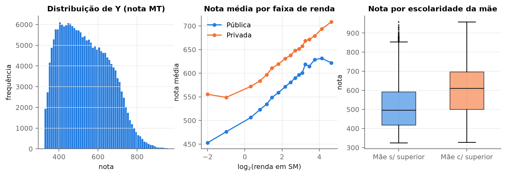{#fig-eda width=100%}

# Métodos {#sec-metodos}

## Modelo amostral {#sec-mod}

Para $i = 1, \dots, n$, com $\bm{x}_i = (1, x_{i1}, x_{i2}, x_{i3})^\top$ e
$\bm{\theta} = (\bm{\beta}, \sigma^2)$, $\bm{\beta} = (\beta_0, \beta_1, \beta_2, \beta_3)^\top$:

$$
Y_i \mid \bm{x}_i, \bm{\theta} \overset{\text{ind}}{\sim} \mathcal{N}(\bm{x}_i^\top\bm{\beta},\ \sigma^2)
\quad\Longleftrightarrow\quad
\bm{Y} \mid \bm{X}, \bm{\theta} \sim \mathcal{N}_n(\bm{X}\bm{\beta},\ \sigma^2 \bm{I}_n),
$$ {#eq-modelo}

em que $\bm{X}$ ($n \times p$, $p = 4$) é a matriz de delineamento. A função de verossimilhança é

$$
L(\bm{\theta} \mid \bm{Y}, \bm{X}) = p(\bm{Y} \mid \bm{X}, \bm{\theta})
= (2\pi\sigma^2)^{-n/2} \exp\left\{-\frac{(\bm{Y}-\bm{X}\bm{\beta})^\top(\bm{Y}-\bm{X}\bm{\beta})}{2\sigma^2}\right\}.
$$ {#eq-verossimilhanca}

Os coeficientes têm leitura direta. $\beta_0$ é a nota esperada de um aluno de escola pública, com
renda familiar de 1 SM e mãe sem ensino superior. $\beta_1$ é a variação esperada quando a renda
dobra, e $\beta_2$ e $\beta_3$ são as diferenças associadas à escola privada e à mãe com ensino
superior, mantidas as demais variáveis.

## Inferência frequentista {#sec-freq}

Igualando o escore a zero, $\partial \ell / \partial \bm{\beta} = \bm{X}^\top(\bm{Y}-\bm{X}\bm{\beta})/\sigma^2 = \bm{0}$
e $\partial \ell / \partial \sigma^2 = -n/(2\sigma^2) + \mathrm{SQR}(\bm\beta)/(2\sigma^4) = 0$:

$$
\hat{\bm{\beta}} = (\bm{X}^\top\bm{X})^{-1}\bm{X}^\top\bm{Y},
\qquad
\hat{\sigma}^2 = \frac{(\bm{Y}-\bm{X}\hat{\bm{\beta}})^\top(\bm{Y}-\bm{X}\hat{\bm{\beta}})}{n}.
$$ {#eq-emv}

A **informação de Fisher observada**, $\bm{J}(\hat{\bm\theta}) = -\partial^2 \ell / \partial\bm\theta\,\partial\bm\theta^\top \big|_{\hat{\bm\theta}}$, é bloco-diagonal:

$$
\bm{J}(\hat{\bm{\theta}}) =
\begin{pmatrix}
\bm{X}^\top\bm{X}/\hat\sigma^2 & \bm{0} \\
\bm{0}^\top & n/(2\hat\sigma^4)
\end{pmatrix},
\qquad
\widehat{\mathrm{EP}}(\hat\theta_j) = \sqrt{[\bm{J}(\hat{\bm\theta})^{-1}]_{jj}},
$$ {#eq-fisher}

e o IC assintótico de 95% (Wald) é $\hat\theta_j \pm 1{,}96\,\widehat{\mathrm{EP}}(\hat\theta_j)$. A
matriz analítica é conferida com a Hessiana numérica, obtida por diferenças finitas da
log-verossimilhança.

**Predição pontual clássica.** Para um novo vetor $\bm{x}_{new}$, $\hat{Y}_{new} = \bm{x}_{new}^\top\hat{\bm\beta}$,
com intervalo de predição

$$
\hat Y_{new} \pm t_{n-p;\,0{,}975}\, s\sqrt{1+\bm{x}_{new}^\top(\bm X^\top\bm X)^{-1}\bm{x}_{new}},
\qquad s^2 = \frac{\mathrm{SQR}(\hat{\bm\beta})}{n-p}.
$$ {#eq-ip}

**Qualidade do ajuste.** Usa-se o coeficiente de determinação $R^2 = 1 - \mathrm{SQR}/\mathrm{SQT}$, em
que $\mathrm{SQT} = \sum_i (Y_i - \bar Y)^2$, e sua versão ajustada,
$R^2_{aj} = 1 - [\mathrm{SQR}/(n-p)]/[\mathrm{SQT}/(n-1)]$.

## Inferência bayesiana conjugada {#sec-bayes}

A verossimilhança $p(\bm Y \mid \bm X, \bm\theta)$ é a mesma da @eq-verossimilhanca. Escrevendo
$\mathrm{SQR}(\bm\beta) = \mathrm{SQR}(\hat{\bm\beta}) + (\bm\beta-\hat{\bm\beta})^\top\bm X^\top\bm X(\bm\beta-\hat{\bm\beta})$,
o núcleo em $\bm\beta$ é Normal e o núcleo em $\sigma^2$ é Gama-Inversa. Isso sugere a priori
conjugada **Normal–Gama-Inversa** (NIG; equivalente à Normal–Gama na precisão $\tau = 1/\sigma^2$,
vista no Módulo 03):

$$
\bm\beta \mid \sigma^2 \sim \mathcal N_p(\bm m_0,\ \sigma^2\bm\Lambda_0^{-1}),
\qquad
\sigma^2 \sim \mathcal{GI}(a_0, b_0),
$$ {#eq-nig}

$$
p(\bm\beta,\sigma^2) \propto (\sigma^2)^{-(a_0 + p/2 + 1)}
\exp\left\{-\frac{2b_0 + (\bm\beta-\bm m_0)^\top\bm\Lambda_0(\bm\beta-\bm m_0)}{2\sigma^2}\right\}.
$$

Pelo Teorema de Bayes, $p(\bm\theta \mid \bm Y, \bm X) \propto p(\bm Y \mid \bm X, \bm\theta)\, p(\bm\theta)$.
Completando o quadrado em $\bm\beta$ no expoente, obtém-se novamente uma NIG:

$$
\boxed{
\begin{aligned}
\bm\Lambda_n &= \bm\Lambda_0 + \bm X^\top\bm X, &
\bm m_n &= \bm\Lambda_n^{-1}(\bm\Lambda_0\bm m_0 + \bm X^\top\bm Y),\\
a_n &= a_0 + n/2, &
b_n &= b_0 + \tfrac12\left(\bm Y^\top\bm Y + \bm m_0^\top\bm\Lambda_0\bm m_0 - \bm m_n^\top\bm\Lambda_n\bm m_n\right).
\end{aligned}}
$$ {#eq-posteriori}

Integrando $\sigma^2$, as **marginais a posteriori** são
$\sigma^2 \mid \bm Y \sim \mathcal{GI}(a_n, b_n)$ e
$\bm\beta \mid \bm Y \sim t_{2a_n}\!\left(\bm m_n,\ \tfrac{b_n}{a_n}\bm\Lambda_n^{-1}\right)$
(t de Student multivariada) — a generalização da marginal $t$ de $\mu$ do exemplo dos leitões.
Note que $\bm m_n$ é uma **média ponderada** entre a priori $\bm m_0$ e o EMV $\hat{\bm\beta}$, com pesos
$\bm\Lambda_0$ e $\bm X^\top\bm X$: quando $n \to \infty$, $\bm X^\top\bm X$ domina e $\bm m_n \to \hat{\bm\beta}$.

## Especificação das prioris {#sec-prioris}

**Cenário (a): priori não informativa de Jeffreys.**

$$
p(\bm\beta, \sigma^2) \propto \frac{1}{\sigma^2},
$$ {#eq-jeffreys}

uniforme imprópria em $\bm\beta$ e $p(\sigma^2) \propto 1/\sigma^2$, como no Módulo 06.
É o caso-limite da NIG com $\bm\Lambda_0 = \bm 0$, $a_0 = -p/2$ e $b_0 = 0$. A posteriori é própria
para $n > p$ e resulta em

$$
\bm\beta \mid \bm Y \sim t_{n-p}\!\left(\hat{\bm\beta},\ s^2(\bm X^\top\bm X)^{-1}\right),
\qquad
\sigma^2 \mid \bm Y \sim \mathcal{GI}\!\left(\tfrac{n-p}{2},\ \tfrac{\mathrm{SQR}(\hat{\bm\beta})}{2}\right),
$$

isto é, **centrada exatamente no EMV**: numericamente as duas abordagens coincidem, mas a
interpretação não (@sec-filosofia).

**Cenário (b): priori informativa (*power prior* da edição anterior).** Fonte:
`{python} META["fonte_priori_informativa"]`. O conhecimento prévio vem da edição anterior do ENEM,
com a mesma especificação e as mesmas variáveis. O procedimento segue @ibrahim2000:

1. calcula-se a posteriori de Jeffreys com os dados do ano anterior,
   $\mathrm{NIG}(\bm m^*, \bm\Lambda^*, a^*, b^*)$;
2. a informação é **rebaixada** para equivaler a $n_0$ observações, para que a base anterior
   (quase um milhão de linhas) não "engula" o ano corrente e para que o peso da priori seja explícito:

$$
\bm m_0 = \bm m^*,\qquad \bm\Lambda_0 = \frac{n_0}{n_{ant}}\bm\Lambda^*,\qquad a_0 = \frac{n_0}{2},\qquad b_0 = a_0\,\frac{b^*}{a^*}.
$$ {#eq-power}

Com isso, $\E[\sigma^2] = b_0/(a_0-1) \approx s^2_{ant}$ e $\Var(\bm\beta)$ a priori é cerca de
$n_{ant}/n_0$ vezes maior que a variância a posteriori do ano anterior. Adota-se
$n_0 =$ `{python} N0_PRIOR`. Com $n =$ `{python} fmt(META["n_amostra"],0)`, a priori responde por cerca de
`{python} fmt(100*peso_priori,0)`% da informação total, $n_0/(n_0+n)$.

## Amostragem da posteriori por MCMC {#sec-mcmc}

Embora a posteriori seja conhecida em forma fechada, ela é também obtida por três algoritmos MCMC
[@gamerman2006]. O contraste **exato × estocástico** valida as implementações, como pede o enunciado.

**Amostrador de Gibbs.** As condicionais completas saem diretamente do núcleo da posteriori:

$$
\begin{aligned}
\bm\beta \mid \sigma^2, \bm Y &\sim \mathcal N_p\!\left(\bm m_n,\ \sigma^2\bm\Lambda_n^{-1}\right),\\
\sigma^2 \mid \bm\beta, \bm Y &\sim \mathcal{GI}\!\left(a_0 + \tfrac{n+p}{2},\ b_0 + \tfrac12\left[\mathrm{SQR}(\bm\beta) + (\bm\beta-\bm m_0)^\top\bm\Lambda_0(\bm\beta-\bm m_0)\right]\right).
\end{aligned}
$$ {#eq-gibbs}

**Metropolis–Hastings de passeio aleatório.** Em $\bm\phi = (\bm\beta, \log\sigma^2)$, usa-se a
proposta $\bm\phi^* \sim \mathcal N(\bm\phi^{(t-1)}, c^2\bm\Sigma)$, com $\bm\Sigma$ da aproximação de
Laplace e $c = 2{,}38/\sqrt{d}$. Como a proposta é simétrica,

$$
\alpha = \min\left\{1,\ \frac{p(\bm\phi^* \mid \bm Y)}{p(\bm\phi^{(t-1)} \mid \bm Y)}\right\},
\qquad p(\bm\phi \mid \bm Y) = p(\bm\beta, \sigma^2 \mid \bm Y)\cdot\sigma^2 \ \text{(jacobiano)},
$$ {#eq-mh}

e a constante normalizadora $p(\bm Y)$ se cancela, o que torna o algoritmo operacional.

**Pacote estruturado: PyMC (NUTS).** O mesmo modelo é ajustado no PyMC (Hamiltonian Monte
Carlo/NUTS); o arquivo `models/nig_regression.stan` traz a versão equivalente em Stan.

**Configuração.** Para cada priori e algoritmo, rodam-se `{python} META["n_cadeias"]` cadeias com
`{python} fmt(META["n_draws"],0)` iterações após `{python} fmt(META["n_burnin"],0)` de aquecimento,
a partir de pontos iniciais sobredispersos. O NUTS usa metade das iterações, porque suas amostras são
bem menos autocorrelacionadas.

**Protocolo de convergência.**

1. **Gráficos de traço** com aquecimento destacado e cadeias iniciadas em pontos sobredispersos;
2. **densidades sobrepostas** por cadeia (devem coincidir);
3. **ACF** (alta autocorrelação reduz o tamanho efetivo de amostra);
4. **$\hat R$ de Gelman–Rubin**, clássico [@gelman1992],
   $\hat R = \sqrt{\hat V/W}$ com $\hat V = \frac{N-1}{N}W + \frac{B}{N}$, e na versão *rank-normalized split*
   [@vehtari2021];
5. **ESS** bulk e tail, $\mathrm{ESS} = MN / (1 + 2\sum_{k\ge1}\rho_k)$.

Critério adotado: $\hat R < 1{,}01$ e ESS > 400 para todos os parâmetros.

## Distribuição preditiva a posteriori {#sec-pred-met}

Para um novo perfil $\bm x_{new}$, a distribuição preditiva é a mistura da verossimilhança no novo
ponto pela posteriori:

$$
p(Y_{new} \mid \bm Y, \bm X) = \int_{\Theta} p(Y_{new} \mid \bm x_{new}, \bm\theta)\, p(\bm\theta \mid \bm Y, \bm X)\, d\bm\theta .
$$ {#eq-preditiva}

**Forma analítica.** Integrando primeiro $\bm\beta$ (convolução de Normais) e depois $\sigma^2$
(mistura Normal–Gama-Inversa):

$$
Y_{new} \mid \bm Y \sim t_{2a_n}\!\left(\bm x_{new}^\top\bm m_n,\ \frac{b_n}{a_n}\left(1 + \bm x_{new}^\top\bm\Lambda_n^{-1}\bm x_{new}\right)\right).
$$ {#eq-preditiva-t}

O termo "1" é a variabilidade intrínseca de um aluno; $\bm x_{new}^\top\bm\Lambda_n^{-1}\bm x_{new}$ é a
incerteza sobre $\bm\beta$, que vai a zero com $n$.

**Avaliação por Monte Carlo (composição).** Para $s = 1,\dots,S$: (i) $\bm\theta^{(s)} \sim p(\bm\theta \mid \bm Y)$
(amostras do Gibbs); (ii) $Y_{new}^{(s)} \sim \mathcal N(\bm x_{new}^\top\bm\beta^{(s)}, \sigma^{2(s)})$. Os
$Y_{new}^{(s)}$ são amostras exatas da integral da @eq-preditiva. Deles se extraem a média, a mediana
e o **HPD 95%**, o menor intervalo que contém 95% das amostras [@chen1999]. A adequação global do
modelo é avaliada por uma checagem preditiva a posteriori (PPC), que compara a densidade de $Y$
observado com réplicas geradas pela preditiva [@gelman2014].

## Critérios de comparação {#sec-crit-met}

$$
\mathrm{AIC} = -2\ell(\hat{\bm\theta}) + 2k,\qquad \mathrm{BIC} = -2\ell(\hat{\bm\theta}) + k\log n,\qquad k = p+1;
$$ {#eq-aic}

$$
\mathrm{WAIC} = -2\left(\underbrace{\sum_{i=1}^n \log \tfrac1S\sum_{s} p(y_i\mid\bm\theta^{(s)})}_{\mathrm{lppd}} - \underbrace{\sum_{i=1}^n \Var_s\!\left[\log p(y_i\mid\bm\theta^{(s)})\right]}_{p_{\mathrm{WAIC}}}\right),
\qquad
\mathrm{LOOIC} = -2\sum_{i=1}^n \log p(y_i \mid \bm y_{-i}),
$$ {#eq-waic}

com o WAIC de @watanabe2010 e o LOO-CV aproximado por *Pareto-smoothed importance sampling*
[@vehtari2017]. Reporta-se também o DIC [@spiegelhalter2002], visto no Módulo 02.

## Estudo assintótico {#sec-assint-met}

Para tamanhos crescentes de amostra (sub-amostras aninhadas da base completa, até
$N =$ `{python} fmt(META["n_base_completa"],0)`), calcula-se a posteriori **exata** nos dois cenários
e o IC do EMV. O objetivo é observar a dominância da verossimilhança sobre a priori e a convergência
prevista pelo teorema de Bernstein–von Mises.

# Resultados {#sec-resultados}

## Estimação por máxima verossimilhança {#sec-res-emv}

```{python}
#| output: asis
#| label: tbl-emv
#| tbl-cap: "Estimativas de máxima verossimilhança, erros-padrão (Fisher observada) e IC 95%."
print(md(A))
```

```{python}
import statsmodels.api as sm
from ib_enem_bayes.config import FEATURES, RESPONSE, SAMPLE_N, SEED, YEAR_MAIN
from ib_enem_bayes.features import processed_path, subsample
_df = subsample(pd.read_parquet(processed_path(YEAR_MAIN)), SAMPLE_N, SEED)
_ols = sm.OLS(_df[RESPONSE].to_numpy(), _df[FEATURES].to_numpy()).fit()
dif_beta_sm = np.max(np.abs(_ols.params - A["estimativa"].to_numpy()[:4]))
```

Mantidas as demais variáveis fixas, dobrar a renda familiar está associado a
`{python} fmt(A.loc["beta_1","estimativa"],1)` pontos a mais na nota; estudar em escola privada,
a `{python} fmt(A.loc["beta_2","estimativa"],1)` pontos; e ter mãe com ensino superior, a
`{python} fmt(A.loc["beta_3","estimativa"],1)` pontos (@tbl-emv). São associações, não efeitos
causais. A informação de Fisher analítica (@eq-fisher) e a Hessiana numérica diferem, no máximo, em
`{python} f"{dif_fisher:.1e}".replace(".", ",")` em termos relativos. A conferência independente com
o `statsmodels` reproduz $\hat{\bm\beta}$ (diferença máxima de
`{python} f"{dif_beta_sm:.1e}".replace(".", ",")`); seus erros-padrão diferem levemente, porque usam
$s^2 = \mathrm{SQR}/(n-p)$ em vez de $\hat\sigma^2$ (Apêndice [-@sec-apendice-uso]).

**Qualidade do ajuste.** O coeficiente de determinação é
$R^2 =$ `{python} fmt(AJ["r2"],3)` (ajustado: `{python} fmt(AJ["r2_ajustado"],3)`): as três variáveis
explicam cerca de `{python} fmt(100*AJ["r2"],0)`% da variância da nota. O desvio-padrão residual,
$\hat\sigma =$ `{python} fmt(AJ["sigma_hat"],1)` pontos, é pouco menor que o desvio-padrão marginal
de $Y$ (`{python} fmt(AJ["dp_y"],1)`). Os coeficientes são estimados com grande precisão, mas a
maior parte da variação entre alunos vem de fatores fora do modelo. Um $R^2$ baixo não invalida as
associações; ele indica que o modelo descreve bem **médias de grupos**, mas não as notas individuais.

```{python}
#| output: asis
#| label: tbl-pred-emv
#| tbl-cap: "Predição frequentista: estimativa pontual, IC 95% da média e intervalo de predição 95%."
print(md(PE, ".1f"))
```

A @tbl-pred-emv mostra essa distinção em números. Para o perfil
"`{python} PE.index[0]`", o IC 95% da **nota média** do grupo tem semiamplitude de
`{python} fmt(meia_ic,1)` pontos, enquanto o intervalo de predição para **um aluno** (@eq-ip) tem
`{python} fmt(meia_ip,1)` pontos. A diferença é o termo "1" sob a raiz, a variabilidade individual
$\sigma^2$, que não diminui com $n$.

## Posteriori exata {#sec-res-post}

```{python}
#| output: asis
#| label: tbl-hiper
#| tbl-cap: "Hiperparâmetros da priori informativa ($\\bm m_0$, DP marginal de $\\bm\\beta$, $a_0$ e $b_0$)."
print(md(HI, ".3f"))
```

A priori (@tbl-hiper) é coerente com o ano corrente em $\beta_0$, $\beta_1$ e $\beta_3$, mas não em
$\beta_2$: no ENEM `{python} YEAR_PRIOR` a diferença privada − pública era de
`{python} fmt(HI.loc["beta_2","m0"],1)` pontos, contra `{python} fmt(A.loc["beta_2","estimativa"],1)`
no EMV de `{python} META["ano_principal"]`. Como o DP a priori de $\beta_2$
(`{python} fmt(HI.loc["beta_2","dp_marginal_beta"],1)`) é largo, o conflito é moderado: a média a
posteriori de $\beta_2$ é puxada para `{python} fmt(PI.loc["beta_2","media"],1)`, e os demais
coeficientes quase não mudam (@tbl-post-exata e @tbl-post-inf). A atualização conjugada (@eq-posteriori) leva a
$a_n =$ `{python} fmt(HPV["a_n"].iloc[0],1)` e $b_n =$ `{python} fmt(HPV["b_n"].iloc[0],0)` sob
Jeffreys, e a $a_n =$ `{python} fmt(HPI["a_n"].iloc[0],1)` e $b_n =$ `{python} fmt(HPI["b_n"].iloc[0],0)`
sob a priori informativa.

```{python}
#| output: asis
#| label: tbl-post-exata
#| tbl-cap: "Posteriori exata (analítica) sob a priori de Jeffreys: média, mediana, DP e HPD 95%."
print(md(PV, ".3f"))
```

```{python}
#| output: asis
#| label: tbl-post-inf
#| tbl-cap: "Posteriori exata (analítica) sob a priori informativa: média, mediana, DP e HPD 95%."
print(md(PI, ".3f"))
```

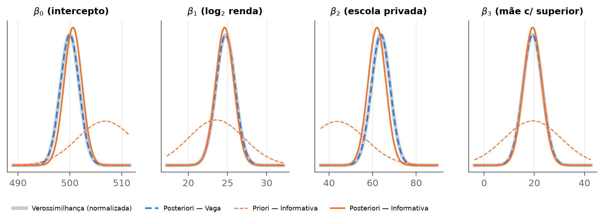{#fig-plp width=100%}

## Convergência e validação dos amostradores {#sec-res-mcmc}

```{python}
#| output: asis
#| label: tbl-conv-resumo
#| tbl-cap: "Resumo dos diagnósticos por priori e algoritmo: pior $\\hat R$ (rank), menores ESS, ACF de defasagem 1 média e taxa de aceitação (MH). A tabela completa, por parâmetro, está no Apêndice A."
ab = {"Gibbs": "Gibbs", "Metropolis–Hastings": "MH", "PyMC (NUTS)": "NUTS"}
res = (CONV.groupby(["cenario", "amostrador"], sort=False)
       .agg(rhat=("rhat_rank", "max"), ess_b=("ess_bulk", "min"), ess_t=("ess_tail", "min"),
            acf=("acf_lag1", "mean"), acc=("taxa_aceitacao", "mean"), ok=("convergiu", "all"))
       .reset_index())
res["amostrador"] = res["amostrador"].map(ab)
res["acc"] = (100 * res["acc"]).map(lambda v: "—" if pd.isna(v) else f"{v:.1f}%")
res["ok"] = res["ok"].map({True: "sim", False: "não"})
res.columns = ["Priori", "Alg.", "Rhat máx.", "ESS bulk mín.", "ESS tail mín.", "ACF(1) média", "Aceitação", "OK"]
print(md(res, ["", "", ".3f", ".0f", ".0f", ".2f", "", ""], index=False))
```

Todos os critérios foram atendidos: **`{python} "sim" if META["todos_convergiram"] else "não — aumentar N_DRAWS/afinamento do MH em config.py"`**
(@tbl-conv-resumo). O Gibbs gera amostras quase independentes (ACF lag-1 máxima de
`{python} fmt(g.acf_lag1.max(),2)`), pois $\bm\beta$ é amostrado em bloco. O MH, com taxa de
aceitação de `{python} fmt(100*mh.taxa_aceitacao.mean(),1)`%, próxima do ótimo teórico para dimensão
baixa (que vai de 44% em $d = 1$ a 23,4% quando $d \to \infty$; @gelman1996), é bem mais
autocorrelacionado: ESS bulk mínimo de `{python} fmt(mh.ess_bulk.min(),0)` contra
`{python} fmt(g.ess_bulk.min(),0)` do Gibbs, com o mesmo número de iterações. O NUTS fica entre os
dois (ESS bulk mínimo de `{python} fmt(nuts.ess_bulk.min(),0)` com metade das iterações).

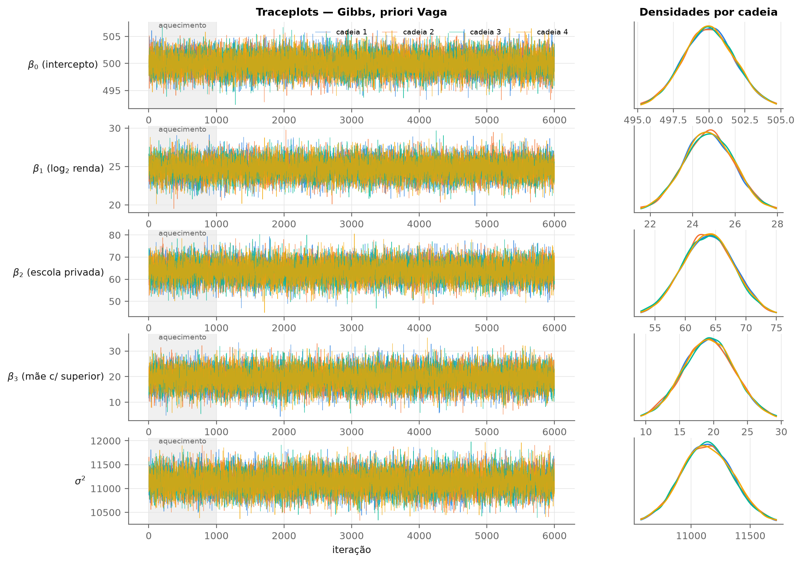{#fig-trace-g width=95%}

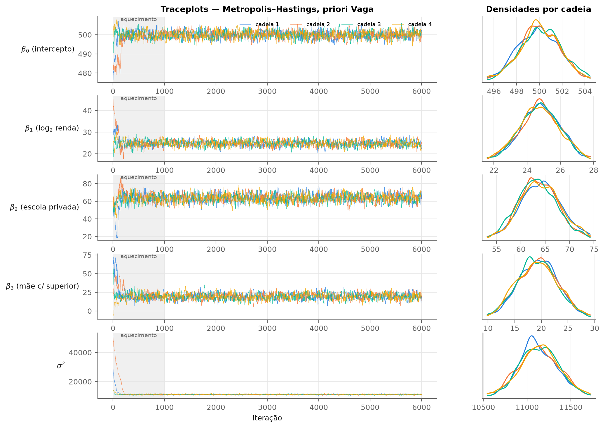{#fig-trace-mh width=95%}

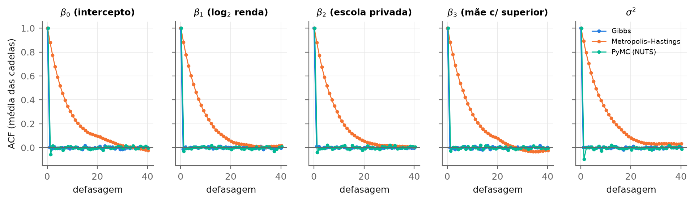{#fig-acf width=100%}

**Posteriori exata × aproximação estocástica.** As densidades estimadas pelos três algoritmos se
sobrepõem às marginais analíticas (@fig-exata-v e @fig-exata-i).

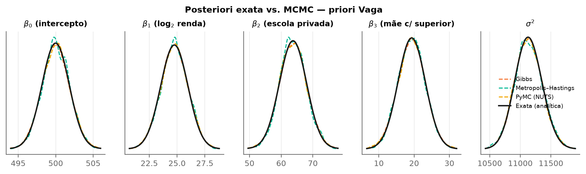{#fig-exata-v width=100%}

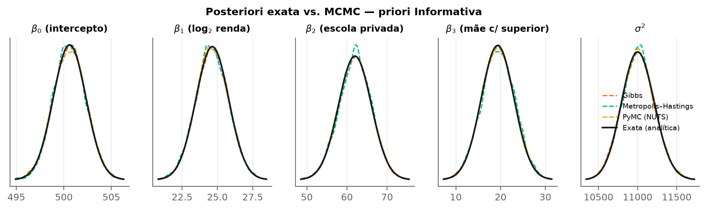{#fig-exata-i width=100%}

```{python}
#| output: asis
#| label: tbl-exata-mcmc
#| tbl-cap: "Média a posteriori: exata vs. MCMC (cenário informativo) e erro relativo ao DP a posteriori."
pm = tab("C_posteriori_mcmc")
pm = pm[pm.cenario == "Informativa"]
rows = []
for s, sub in pm.groupby("amostrador", sort=False):
    for par in PI.index:
        rows.append({"amostrador": s, "parametro": par, "exata": PI.loc[par,"media"], "mcmc": sub.loc[par,"media"],
                     "erro/DP": (sub.loc[par,"media"] - PI.loc[par,"media"]) / PI.loc[par,"dp"]})
print(md(pd.DataFrame(rows), ".3f", index=False))
```

As diferenças são frações pequenas do desvio-padrão a posteriori (@tbl-exata-mcmc), compatíveis com
o erro de Monte Carlo ($\mathrm{EP}_{MC} \approx \mathrm{DP}/\sqrt{\mathrm{ESS}}$).

## Distribuição preditiva {#sec-res-pred}

```{python}
#| output: asis
#| label: tbl-pred
#| tbl-cap: "Preditiva a posteriori: média e mediana (Monte Carlo) e HPD 95% por Monte Carlo e exato (t)."
pr = PRED.drop(columns=["media_exata"]).replace({"Informativa": "Inform."}).copy()
pr.columns = ["Priori", "Perfil", "Média MC", "Mediana MC", "HPD inf (MC)", "HPD sup (MC)", "HPD inf (exato)", "HPD sup (exato)"]
print(md(pr, ".1f", index=False))
```

Para um aluno de escola pública, com renda de 1 SM e mãe sem ensino superior, a preditiva sob
Jeffreys tem média `{python} fmt(PRED.loc[0,"media_mc"],1)` e HPD 95% exato de
[`{python} fmt(PRED.loc[0,"hpd_inf_exato"],1)`; `{python} fmt(PRED.loc[0,"hpd_sup_exato"],1)`]: há 95%
de probabilidade de a nota desse aluno cair nessa faixa (@tbl-pred). A largura vem quase toda de
$\sigma^2$; a incerteza sobre $\bm\beta$ é desprezível com esse $n$.

Os HPDs de Monte Carlo ficam a poucos pontos dos exatos. A diferença é erro de Monte Carlo nos
extremos do intervalo: com $S =$ `{python} fmt(META["n_cadeias"]*META["n_draws"],0)` amostras, os
limites do HPD variam alguns pontos de uma semente para outra, e o erro some quando $S$ aumenta.

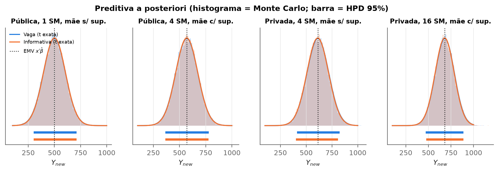{#fig-pred width=100%}

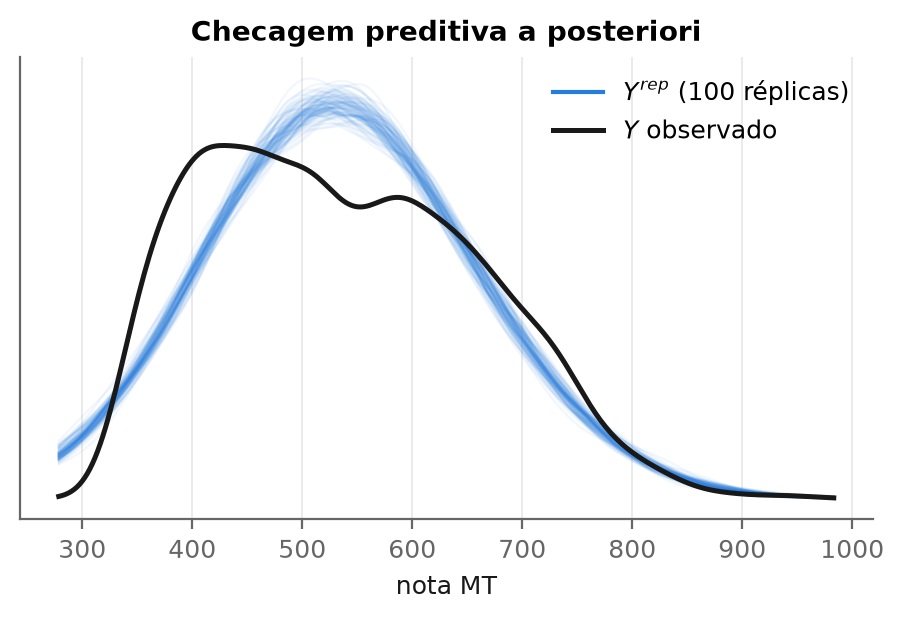{#fig-ppc width=65%}

A checagem preditiva (@fig-ppc) mostra onde o modelo normal homocedástico é limitado. A nota
observada tem assimetria à direita e um piso na escala TRI (mínimo de
`{python} fmt(DESC.loc["nota_mt","min"],1)` pontos na amostra). As réplicas põem massa abaixo desse
piso, subestimam a concentração de notas entre 380 e 480 e não reproduzem o "ombro" em torno de 600
pontos, que sugere uma mistura de subpopulações (como os alunos da rede privada).

## Comparação EMV × Bayes {#sec-res-comp}

```{python}
#| output: asis
#| label: tbl-lado
#| tbl-cap: "Comparação lado a lado: EMV com IC 95% vs. média/mediana a posteriori com HPD 95% (Gibbs) nos dois cenários de priori."
sb = tab("E_lado_a_lado").reset_index(drop=True)
sb["metodo"] = sb["metodo"].str.replace(": média + HPD 95%", " (média, HPD)").str.replace("EMV + IC 95% (Wald)", "EMV (IC Wald)")
sb.columns = ["Par.", "Método", "Pontual", "Mediana", "Inf. 95%", "Sup. 95%", "Amplitude"]
print(md(sb.fillna(""), ".2f", index=False))
```

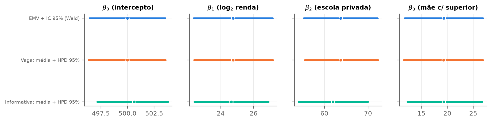{#fig-forest width=100%}

Jeffreys reproduz o EMV, com centro idêntico e intervalo $t_{n-p}$ em vez de $z$. A priori
informativa encurta levemente os intervalos e puxa as estimativas na direção de $\bm m_0$, sobretudo
em $\beta_2$ (@tbl-lado e @fig-forest).

## Critérios de informação {#sec-res-ic}

```{python}
#| output: asis
#| label: tbl-ic
#| tbl-cap: "Critérios de informação (escala deviance; menor é melhor)."
cols = ["aic","bic","dic","p_dic","waic","p_waic","se_waic","looic","p_loo","pareto_k_max"]
icT = IC[[c for c in cols if c in IC.columns]].T
icT.index = ["AIC","BIC","DIC","p_D","WAIC","p_WAIC","EP(WAIC)","LOOIC","p_LOO","máx. k de Pareto"]
print(icT.to_markdown(floatfmt=".2f").replace("nan", "—"))
```

```{python}
aic = IC.loc["EMV","aic"]; waic_v = IC.loc["Bayes — Vaga","waic"]
```

Com $n$ grande e priori vaga, AIC (`{python} fmt(aic,1)`), DIC, WAIC (`{python} fmt(waic_v,1)`) e
LOOIC praticamente coincidem (@tbl-ic). O número efetivo de parâmetros sob a priori vaga
($p_{\mathrm{WAIC}} =$ `{python} fmt(IC.loc["Bayes — Vaga","p_waic"],2)`) recupera os $k = 5$
parâmetros do AIC. Sob a priori informativa ele cai para
`{python} fmt(IC.loc["Bayes — Informativa","p_waic"],2)`, porque a priori restringe os coeficientes.
A diferença conceitual permanece: AIC/BIC avaliam o **estimador pontual** $\hat{\bm\theta}$, enquanto
WAIC/LOO avaliam a **preditiva a posteriori inteira**, incorporando a incerteza sobre $\bm\theta$. O
BIC penaliza mais ($\log n > 2$) e aproxima $-2\log p(\bm Y)$, cujo valor exato, sob a priori
informativa (própria), é `{python} fmt(-2*META["log_evidencia"]["Informativa"],1)`. A evidência não
está definida para a priori imprópria de Jeffreys, e por isso não se calcula Fator de Bayes entre os
cenários. O maior $\hat k$ de Pareto foi `{python} fmt(IC['pareto_k_max'].max(),2)` (limite usual: 0,7),
`{python} 'o que indica que a aproximação PSIS-LOO é confiável' if IC['pareto_k_max'].max() < 0.7 else 'acima do limite — conferir as observações influentes'`.

## Dominância da verossimilhança {#sec-assintotico}

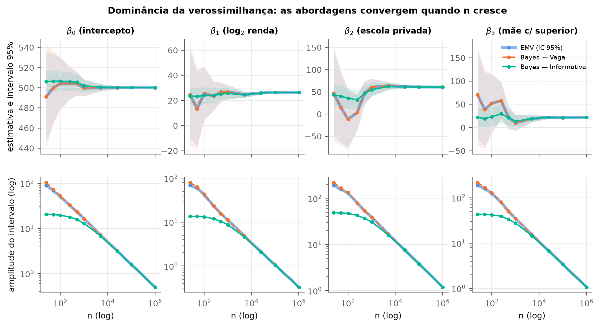{#fig-assint width=100%}

A amplitude dos intervalos cai a uma taxa $\propto n^{-1/2}$ (reta de inclinação $-1/2$ em escala
log-log; @fig-assint). Com $n$ pequeno, a priori informativa equivale a acrescentar
$n_0 =$ `{python} N0_PRIOR` observações "fictícias" do ano anterior e domina; quando $n \gg n_0$, a
verossimilhança domina e EMV, Bayes-vago e Bayes-informativo convergem.

# Discussão {#sec-discussao}

## Intervalo de confiança × intervalo de credibilidade {#sec-filosofia}

Mesmo quando os números coincidem (Jeffreys × EMV, @tbl-lado), as afirmações são diferentes:

* **IC 95% frequentista.** $\bm\beta$ é **fixo e desconhecido**; o aleatório é o intervalo
  $[L(\bm Y), U(\bm Y)]$. A probabilidade de 95% refere-se ao **procedimento**: em repetições
  hipotéticas da amostragem, 95% dos intervalos construídos cobririam o verdadeiro $\beta_j$. Para o
  intervalo **observado**, $P(\beta_j \in [\ell, u]) \in \{0, 1\}$, e não se pode dizer que "há 95% de
  chance de $\beta_j$ estar ali".
* **Intervalo de credibilidade HPD 95%.** $\bm\beta$ é **variável aleatória** que representa a
  incerteza do analista; os dados observados são fixos. A afirmação é direta:
  $P(\beta_j \in [\ell, u] \mid \bm Y, \bm X) = 0{,}95$, condicional ao que foi efetivamente
  observado e à priori declarada. O HPD é ainda o **menor** intervalo com essa probabilidade, e
  todo ponto dentro dele tem densidade maior que qualquer ponto fora.
* **Consequências práticas.** O intervalo bayesiano responde à pergunta que normalmente se faz
  ("onde provavelmente está $\beta_j$?"), não depende de resultados assintóticos (vale para todo $n$
  sob o modelo) e se estende naturalmente à predição (@tbl-pred). Em troca, exige explicitar
  $p(\bm\theta)$, e o resultado é condicional a essa escolha — por isso a análise de sensibilidade
  com dois cenários. O IC tem garantia de cobertura sem priori, mas sua validade aqui é
  assintótica (Wald) e sua interpretação é sobre procedimentos, não sobre o parâmetro.
* **Convergência.** Sob regularidade, o teorema de Bernstein–von Mises garante que a posteriori se
  aproxima de $\mathcal N(\hat{\bm\theta}, \bm J(\hat{\bm\theta})^{-1})$, de modo que HPD e IC
  coincidem numericamente quando $n \to \infty$ (@fig-assint). Para a priori de Jeffreys no modelo
  linear normal, a coincidência dos centros é exata para todo $n$ (intervalos t), e a diferença de
  amplitude vem só de $t_{n-p}$ versus $z$ e de $s^2$ versus $\hat\sigma^2$.

## Limitações e extensões {#sec-limitacoes}

* **Forma da distribuição.** A Normal homocedástica capta a média condicional, mas não a assimetria
  nem o piso da escala TRI (@fig-ppc). Extensões naturais são uma verossimilhança skew-normal ou
  censurada no piso, variância por tipo de escola ou um termo de interação; a @fig-eda sugere que o
  efeito da renda difere entre as redes.
* **Poder explicativo.** Com $R^2 =$ `{python} fmt(AJ["r2"],3)`, o modelo serve para comparar grupos,
  não para prever o desempenho de um aluno.
* **Causalidade.** Os coeficientes são associações; renda, escola e escolaridade materna são
  correlacionadas entre si e com fatores não observados.
* **Escolhas do analista.** O peso $n_0 =$ `{python} N0_PRIOR` da priori informativa e os pontos médios
  das faixas de renda (0,25 e 25 SM nos extremos) são convenções. O conflito em $\beta_2$ entre
  `{python} YEAR_PRIOR` e `{python} META["ano_principal"]` mostra que a escolha de $n_0$ importa quando
  o ano anterior difere do atual.

# Conclusões {#sec-conclusoes}

1. Renda familiar, escola privada e escolaridade materna estão positivamente associadas à nota de
   Matemática; as três abordagens concordam em sinal, magnitude e incerteza para o $n$ analisado.
2. A posteriori conjugada NIG permite validar três algoritmos MCMC contra a solução exata; os três
   convergem, e o Gibbs é o mais eficiente (ESS $\approx$ número de iterações), enquanto o MH exige mais iterações.
3. A preditiva a posteriori, obtida analiticamente (t de Student) e por composição de Monte Carlo,
   incorpora a incerteza sobre $\bm\theta$ e fornece HPDs diretamente interpretáveis.
4. A priori informativa importa para amostras pequenas e se torna irrelevante quando $n \gg n_0$.
   O único conflito entre priori e dados está no efeito da escola privada, bem menor em
   `{python} YEAR_PRIOR` do que em `{python} META["ano_principal"]`. A escolha entre paradigmas é,
   sobretudo, interpretativa.
5. O modelo explica cerca de `{python} fmt(100*AJ["r2"],0)`% da variância da nota
   ($R^2 =$ `{python} fmt(AJ["r2"],3)`). Ele descreve bem médias de grupos, com intervalos estreitos,
   mas prevê mal notas individuais: o intervalo de predição tem cerca de ±`{python} fmt(meia_ip,0)`
   pontos. O modelo normal homocedástico também não reproduz a forma da distribuição das notas
   (assimetria, piso da escala TRI), como mostra a checagem preditiva.

# Referências {.unnumbered}

::: {#refs}
:::

```{=latex}
\clearpage
\appendix
```

# Diagnósticos completos de convergência {#sec-apendice-diag}

```{python}
#| output: asis
#| label: tbl-conv
#| tbl-cap: "Diagnósticos formais por parâmetro: $\\hat R$ de Gelman–Rubin (clássico) e rank-normalized, ESS bulk/tail e autocorrelação de defasagem 1."
c = CONV.assign(amostrador=CONV.amostrador.map(ab), ok=CONV.convergiu.map({True: "sim", False: "não"}))
c = c[["cenario","amostrador","parametro","rhat_gelman_rubin","rhat_rank","ess_bulk","ess_tail","acf_lag1","ok"]]
c.columns = ["Priori","Alg.","Par.","Rhat GR","Rhat rank","ESS bulk","ESS tail","ACF(1)","OK"]
print(md(c, ["", "", "", ".3f", ".3f", ".0f", ".0f", ".2f", ""], index=False))
```

# Uso do pacote {#sec-apendice-uso}

Os trechos abaixo reproduzem, a partir do pacote, as chamadas usadas em cada etapa do pipeline
(`python -m ib_enem_bayes.modeling.train`).

**Etapa A** (`ib_enem_bayes/modeling/frequentist.py`):

```{python}
#| echo: true
import numpy as np, pandas as pd
from ib_enem_bayes.config import FEATURES, RESPONSE, SAMPLE_N, SEED, YEAR_MAIN
from ib_enem_bayes.features import processed_path, subsample
from ib_enem_bayes.modeling.frequentist import fit_mle

df = subsample(pd.read_parquet(processed_path(YEAR_MAIN)), SAMPLE_N, SEED)
y, X = df[RESPONSE].to_numpy(), df[FEATURES].to_numpy()
mle = fit_mle(y, X)            # forma fechada + J(theta_hat) analítica e numérica
# conferência: J analítica vs. Hessiana numérica (diferenças finitas)
print("máx. |J_analítica - J_numérica| / |J| =",
      f"{np.max(np.abs(mle.fisher_obs - mle.fisher_numeric)) / np.max(np.abs(mle.fisher_obs)):.1e}")
print(f"R² = {mle.r2:.4f}; R² ajustado = {mle.r2_adj:.4f}")
```

```{python}
#| echo: true
# Conferência independente com statsmodels (o EP de β usa s² = SQR/(n-p), por isso difere levemente)
import statsmodels.api as sm
ols = sm.OLS(y, X).fit()
print(pd.DataFrame({"beta_hat": ols.params, "EP_ols": ols.bse}, index=FEATURES).round(3))
```

**Etapa B** (`ib_enem_bayes/modeling/conjugate.py`):

```{python}
#| echo: true
from ib_enem_bayes.modeling.train import build_priors
priors, _ = build_priors(X.shape[1])          # {"Vaga": Jeffreys, "Informativa": power prior}
exact = {lab: pr.update(y, X) for lab, pr in priors.items()}   # atualização conjugada
print({lab: (round(float(post.a), 1), round(float(post.b), 1)) for lab, post in exact.items()})  # (a_n, b_n)
```

**Etapa C** (`ib_enem_bayes/modeling/samplers.py` e `pymc_model.py`):

```{python}
#| echo: true
# Chamadas usadas no pipeline:
#   g  = gibbs(y, X, prior, n_draws + n_burnin, 0, N_CHAINS, seed)
#   mh = metropolis_hastings(y, X, prior, n_draws + n_burnin, 0, N_CHAINS, seed + 1)
#   nuts = fit_pymc(y, X, prior, n_draws, n_burnin, N_CHAINS, seed + 2)
print(f"{META['n_cadeias']} cadeias × {META['n_draws']} iterações após {META['n_burnin']} de aquecimento,"
      " pontos iniciais sobredispersos.")
```

**Etapa D** (`ib_enem_bayes/predictive.py`):

```{python}
#| echo: true
from ib_enem_bayes.config import MODELS_DIR, X_NEW
from ib_enem_bayes.predictive import posterior_predictive_draws, hpd
theta = np.load(MODELS_DIR / "draws_gibbs_vaga.npy").reshape(-1, 5)   # (S, p+1)
x_new = np.array(X_NEW["Pública, 1 SM, mãe s/ sup."])
y_new = posterior_predictive_draws(theta, x_new, np.random.default_rng(1))  # composição
print(f"E[Y_new|Y] ≈ {y_new.mean():.1f}; HPD95% ≈ [{hpd(y_new)[0]:.1f}, {hpd(y_new)[1]:.1f}]")
```



# Código-fonte comentado {#sec-apendice-codigo}

```{python}
#| output: asis
from ib_enem_bayes.config import PROJ_ROOT
for f in ["modeling/frequentist.py", "modeling/conjugate.py", "modeling/samplers.py",
          "modeling/pymc_model.py", "diagnostics.py", "predictive.py", "compare.py"]:
    print(f"\n## `ib_enem_bayes/{f}` {{.unnumbered .unlisted}}\n\n```python\n"
          + (PROJ_ROOT / "ib_enem_bayes" / f).read_text(encoding="utf-8") + "\n```\n")
```
