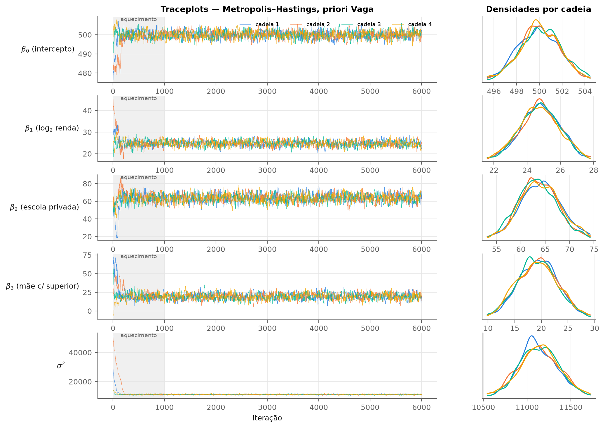
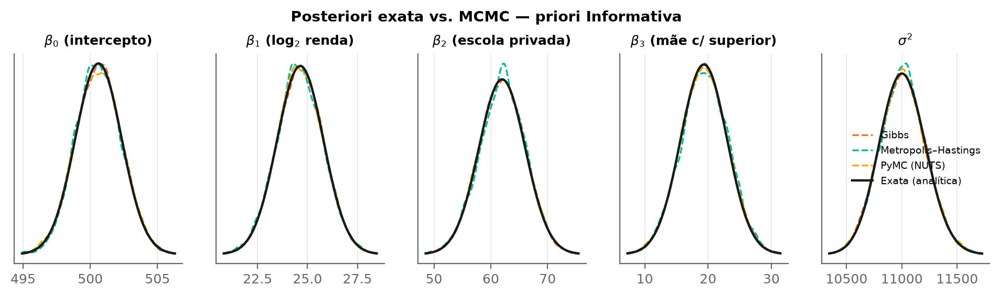
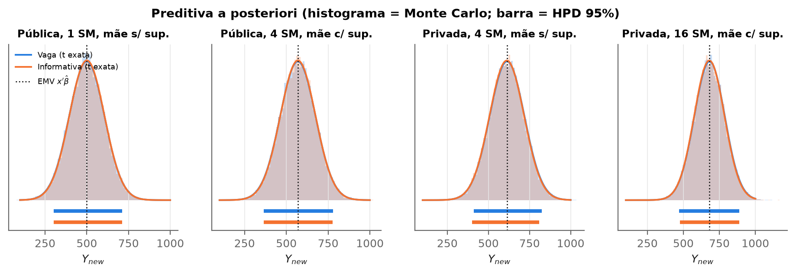

```{python}
import sys, warnings
from pathlib import Path
warnings.filterwarnings("ignore")
sys.path.insert(0, str(Path.cwd())); sys.path.insert(0, str(Path.cwd().parent))
from _common import META, tab, md, fmt
A = tab("A_emv"); PV = tab("B_posteriori_exata_vaga"); PI = tab("B_posteriori_exata_informativa")
CONV = tab("C_convergencia").reset_index(drop=True); IC = tab("E_criterios_informacao")
mh = CONV[CONV.amostrador == "Metropolis–Hastings"]; g = CONV[CONV.amostrador == "Gibbs"]
```

```{python}
#| output: asis
if META["simulado"]:
    print("## Aviso\n\n**Slides gerados com DADOS SIMULADOS** (`make demo`). Rode `make data train report` com os microdados do INEP.\n")
```

## Problema e dados

- **Pergunta:** como renda familiar, tipo de escola e escolaridade da mãe se associam à nota de
  Matemática do ENEM `{python} META["ano_principal"]`?
- **Dados:** microdados INEP; $N =$ `{python} fmt(META["n_base_completa"],0)` participantes válidos;
  amostra de análise $n =$ `{python} fmt(META["n_amostra"],0)`.
- **Modelo:**
$$
Y_i = \beta_0 + \beta_1 \log_2(\text{renda}_i/\text{SM}) + \beta_2\,\text{privada}_i + \beta_3\,\text{mãe\_sup}_i + \varepsilon_i,
\quad \varepsilon_i \overset{iid}{\sim} \mathcal N(0,\sigma^2)
$$
- $\beta_1$ = efeito de **dobrar** a renda; $\bm\theta = (\bm\beta, \sigma^2)$.

{width=85%}

## Etapa A — Máxima verossimilhança

:::: {.columns}
::: {.column width="45%"}
$$
\hat{\bm\beta} = (\bm X^\top\bm X)^{-1}\bm X^\top\bm Y,\quad \hat\sigma^2 = \tfrac{\mathrm{SQR}}{n}
$$
$$
\bm J(\hat{\bm\theta}) = \begin{pmatrix} \bm X^\top\bm X/\hat\sigma^2 & \bm 0\\ \bm 0^\top & n/(2\hat\sigma^4)\end{pmatrix}
$$
EP $= \sqrt{\mathrm{diag}\,\bm J^{-1}}$; IC Wald $\hat\theta_j \pm 1{,}96\,\mathrm{EP}$.

$\bm J$ analítica conferida com a Hessiana numérica.
:::
::: {.column width="55%"}
```{python}
#| output: asis
print(md(A, ".2f"))
```
:::
::::

## Etapa B — Verossimilhança e priori conjugada NIG

$$
p(\bm Y\mid\bm X,\bm\theta) = (2\pi\sigma^2)^{-n/2}\exp\!\Big\{-\tfrac{(\bm Y-\bm X\bm\beta)^\top(\bm Y-\bm X\bm\beta)}{2\sigma^2}\Big\}
$$
$$
\bm\beta\mid\sigma^2 \sim \mathcal N_p(\bm m_0, \sigma^2\bm\Lambda_0^{-1}),\qquad \sigma^2\sim\mathcal{GI}(a_0,b_0)
$$
$$
\begin{aligned}
\bm\Lambda_n &= \bm\Lambda_0 + \bm X^\top\bm X, & \bm m_n &= \bm\Lambda_n^{-1}(\bm\Lambda_0\bm m_0 + \bm X^\top\bm Y),\\
a_n &= a_0 + \tfrac n2, & b_n &= b_0 + \tfrac12(\bm Y^\top\bm Y + \bm m_0^\top\bm\Lambda_0\bm m_0 - \bm m_n^\top\bm\Lambda_n\bm m_n)
\end{aligned}
$$

- Marginais: $\bm\beta\mid\bm Y\sim t_{2a_n}(\bm m_n, \tfrac{b_n}{a_n}\bm\Lambda_n^{-1})$ e $\sigma^2\mid\bm Y\sim\mathcal{GI}(a_n,b_n)$.
- $\bm m_n$ = média **ponderada** entre a priori e o EMV, com pesos $\bm\Lambda_0$ e $\bm X^\top\bm X$.

## Etapa B — Dois cenários de priori

- **(a) Vaga — Jeffreys:** $p(\bm\beta,\sigma^2)\propto 1/\sigma^2$ ($\bm\Lambda_0=\bm 0$, $a_0=-p/2$, $b_0=0$)
  $\Rightarrow \bm\beta\mid\bm Y\sim t_{n-p}(\hat{\bm\beta}, s^2(\bm X^\top\bm X)^{-1})$, **centrada no EMV**.
- **(b) Informativa — power prior:** posteriori do ENEM anterior, rebaixada para valer $n_0 = 500$ observações:
  $\bm m_0=\bm m^*$, $\bm\Lambda_0 = \tfrac{n_0}{n_{ant}}\bm\Lambda^*$, $a_0 = n_0/2$, $b_0 = a_0 b^*/a^*$.

{width=92%}

## Etapa C — Três amostradores para a mesma posteriori

:::: {.columns}
::: {.column width="50%"}
**Gibbs** (condicionais completas):
$$
\begin{aligned}
\bm\beta\mid\sigma^2,\bm Y &\sim \mathcal N_p(\bm m_n, \sigma^2\bm\Lambda_n^{-1})\\
\sigma^2\mid\bm\beta,\bm Y &\sim \mathcal{GI}\big(a_0+\tfrac{n+p}2,\ b_0 + \tfrac12[\mathrm{SQR}(\bm\beta)\\&\qquad + (\bm\beta-\bm m_0)^\top\bm\Lambda_0(\bm\beta-\bm m_0)]\big)
\end{aligned}
$$
:::
::: {.column width="50%"}
**Metropolis–Hastings** em $(\bm\beta,\log\sigma^2)$, passeio aleatório, $c = 2{,}38/\sqrt d$:
$$\alpha = \min\{1, p(\bm\phi^*\mid\bm Y)/p(\bm\phi\mid\bm Y)\}$$
(com jacobiano $\sigma^2$).

**PyMC / NUTS** (equivalente Stan em `models/`).

`{python} META["n_cadeias"]` cadeias × `{python} fmt(META["n_draws"],0)` iterações, aquecimento `{python} fmt(META["n_burnin"],0)`, inícios sobredispersos.
:::
::::

## Etapa C — Diagnóstico gráfico

{width=70%}

## Etapa C — ACF e estatísticas formais

{width=95%}

- Gibbs: ACF(1) máx. `{python} fmt(g.acf_lag1.max(),2)`; ESS bulk mín. `{python} fmt(g.ess_bulk.min(),0)`.
- MH: aceitação `{python} fmt(100*mh.taxa_aceitacao.mean(),1)`%, ACF(1) ≈ `{python} fmt(mh.acf_lag1.mean(),2)`; ESS bulk mín. `{python} fmt(mh.ess_bulk.min(),0)`.
- $\max \hat R$ (todas as cadeias/parâmetros) = `{python} fmt(CONV.rhat_rank.max(),3)`; critério $\hat R<1{,}01$, ESS > 400: **`{python} "atendido" if META["todos_convergiram"] else "NÃO atendido"`**.

## Etapa C — Posteriori exata × MCMC

{width=100%}

- As três aproximações estocásticas recuperam as marginais analíticas ($t$ de Student e Gama-Inversa).
- Diferenças nas médias $\ll$ DP a posteriori, compatíveis com o erro de Monte Carlo $\mathrm{DP}/\sqrt{\mathrm{ESS}}$.

## Etapa D — Preditiva a posteriori

$$
p(Y_{new}\mid\bm Y,\bm X) = \int_\Theta p(Y_{new}\mid\bm x_{new},\bm\theta)\,p(\bm\theta\mid\bm Y,\bm X)\,d\bm\theta
= t_{2a_n}\!\Big(\bm x_{new}^\top\bm m_n,\ \tfrac{b_n}{a_n}(1+\bm x_{new}^\top\bm\Lambda_n^{-1}\bm x_{new})\Big)
$$

Monte Carlo por composição: $\bm\theta^{(s)}\sim p(\bm\theta\mid\bm Y)$, depois $Y^{(s)}_{new}\sim\mathcal N(\bm x_{new}^\top\bm\beta^{(s)},\sigma^{2(s)})$.

{width=95%}

## Etapa E — EMV × Bayes

{width=100%}

- Jeffreys reproduz o EMV (centro idêntico; intervalo $t_{n-p}$ vs. $z$).
- A priori informativa encurta levemente os intervalos e puxa as estimativas na direção de $\bm m_0$.

## Etapa E — Critérios de informação

```{python}
#| output: asis
cols = ["aic","bic","dic","waic","p_waic","looic","p_loo","pareto_k_max"]
icT = IC[[c for c in cols if c in IC.columns]].T
icT.index = ["AIC","BIC","DIC","WAIC","p_WAIC","LOOIC","p_LOO","máx. k Pareto"]
print(icT.to_markdown(floatfmt=".1f").replace("nan", "—"))
```

- AIC ≈ DIC ≈ WAIC ≈ LOOIC com $n$ grande, e $p_{\mathrm{WAIC}}\approx p_{\mathrm{LOO}}\approx k = 5$.
- AIC/BIC avaliam $\hat{\bm\theta}$; WAIC/LOO avaliam a **preditiva inteira**.

## Dominância da verossimilhança

{width=88%}

## IC de confiança × intervalo de credibilidade

:::: {.columns}
::: {.column width="50%"}
**IC 95% (frequentista)**

- $\beta_j$ fixo; o intervalo $[L(\bm Y),U(\bm Y)]$ é aleatório.
- 95% = cobertura do **procedimento** em amostras repetidas.
- Para o IC observado: $P(\beta_j\in[\ell,u])\in\{0,1\}$.
- Validade assintótica (Wald).
:::
::: {.column width="50%"}
**HPD 95% (bayesiano)**

- $\beta_j$ aleatório (incerteza); os dados são fixos.
- $P(\beta_j\in[\ell,u]\mid\bm Y,\bm X)=0{,}95$, uma afirmação direta.
- É o **menor** intervalo com 95% de probabilidade.
- Exato para todo $n$ (sob o modelo), mas condicional à priori.
:::
::::

Bernstein–von Mises: $p(\bm\theta\mid\bm Y)\approx\mathcal N(\hat{\bm\theta},\bm J(\hat{\bm\theta})^{-1})$ quando $n\to\infty$, logo os **números** convergem; a **interpretação** não.

## Conclusões e reprodutibilidade

- Renda, escola privada e escolaridade materna estão associadas a notas maiores; EMV e Bayes concordam com $n$ grande.
- A conjugação NIG permite **validar** Gibbs, MH e NUTS contra a posteriori exata.
- A preditiva a posteriori incorpora a incerteza em $\bm\theta$ e dá HPDs interpretáveis.
- A priori importa quando $n \lesssim n_0$ e some quando $n\gg n_0$.
- Limitação: a Normal homocedástica não capta a assimetria nem o piso da escala TRI (ver PPC).

\vspace{0.5em}
\small Repositório no padrão *Cookiecutter Data Science v2*: `make data && make train && make report`.
