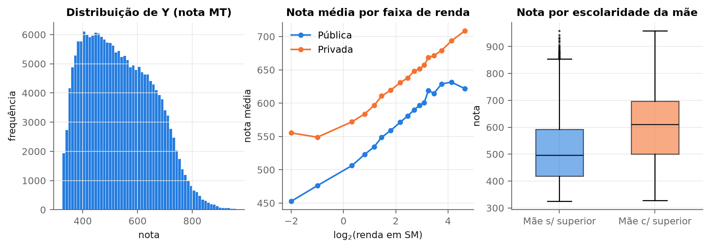
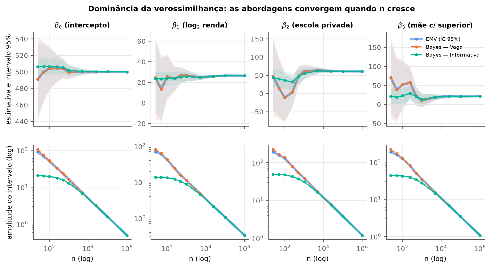
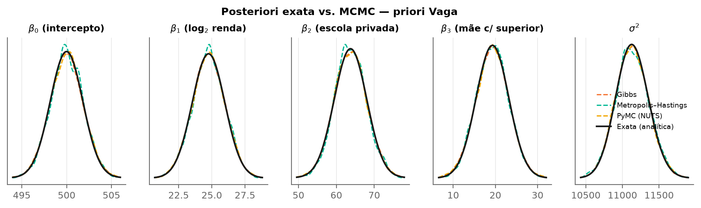
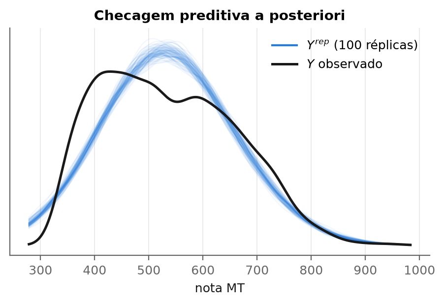
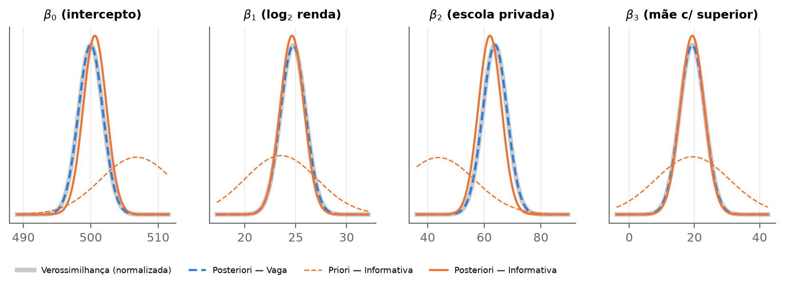
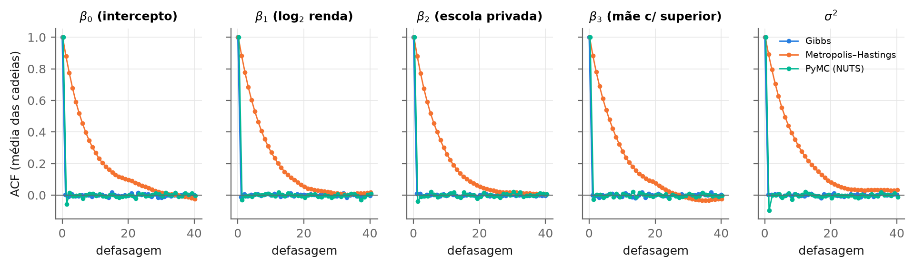
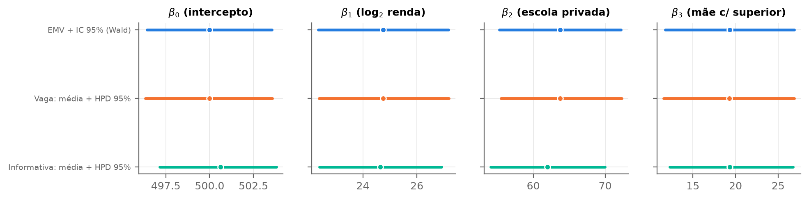

```{python}
import sys, warnings
from pathlib import Path
warnings.filterwarnings("ignore")
sys.path.insert(0, str(Path.cwd())); sys.path.insert(0, str(Path.cwd().parent))
from _common import META, tab, md, fmt
from ib_enem_bayes.config import N0_PRIOR, YEAR_PRIOR
A = tab("A_emv"); PV = tab("B_posteriori_exata_vaga"); PI = tab("B_posteriori_exata_informativa")
CONV = tab("C_convergencia").reset_index(drop=True); IC = tab("E_criterios_informacao")
mh = CONV[CONV.amostrador == "Metropolis–Hastings"]; g = CONV[CONV.amostrador == "Gibbs"]
AJ = tab("A_ajuste")["valor"]; HI = tab("B_hiperparametros_informativa"); DESC = tab("descritivas_amostra")
PRED = tab("D_preditiva").reset_index(drop=True); PE = tab("A_predicao_emv")
PV_ = PRED[PRED.cenario == "Vaga"].set_index("perfil")
gap = PV_["media_exata"].iloc[-1] - PV_["media_exata"].iloc[0]
PE0 = PE.iloc[0]; meia_ic = (PE0.ic_media_sup - PE0.ic_media_inf) / 2; meia_ip = (PE0.ip_sup - PE0.ip_inf) / 2
ANO = META["ano_principal"]
efeitos = A.loc[["beta_1", "beta_2", "beta_3"], "estimativa"]
pm = tab("C_posteriori_mcmc")
erro_max = max(
    abs(pm[(pm.cenario == lab)].loc[par, "media"] - post.loc[par, "media"]).max() / post.loc[par, "dp"]
    for lab, post in {"Vaga": PV, "Informativa": PI}.items() for par in post.index
)

def kpis(items):
    """Linha de números em destaque: [(número, legenda), ...] -> bloco LaTeX."""
    w = 0.95 / len(items)
    cols = "".join(
        f"\\begin{{column}}{{{w:.2f}\\textwidth}}\\kpi{{{big}}}{{{lab}}}\\end{{column}}"
        for big, lab in items
    ).replace("%", "\\%")
    print("```{=latex}\n\\begin{columns}[T]" + cols + "\\end{columns}\n```")
```

```{python}
#| output: asis
if META["simulado"]:
    print("## Aviso\n\n**Slides gerados com DADOS SIMULADOS** (`make demo`). Rode `make data train report` com os microdados do INEP.\n")
```

## A pergunta

- **O que queremos saber:** quanto a renda da família, o tipo de escola e a escolaridade da mãe se
  associam à nota de Matemática do ENEM `{python} ANO`.
- **Por que importa:** dimensionar a desigualdade de desempenho e mostrar quanto dela esses três
  fatores, observáveis antes da prova, conseguem explicar.
- **Com que dados:** microdados oficiais do INEP, com `{python} fmt(META["n_base_completa"],0)`
  participantes válidos. A edição de `{python} YEAR_PRIOR` serve como conhecimento prévio.
- **Como respondemos:** com duas escolas de estatística (a clássica e a bayesiana) aplicadas ao mesmo
  modelo, para ver se chegam à mesma resposta.

## Em uma frase

**Renda, escola e escolaridade da mãe separam os perfis analisados em até `{python} fmt(gap,0)`
pontos na média, mas explicam só `{python} fmt(100*AJ["r2"],0)`% das diferenças entre um aluno e outro.**

\vspace{1em}

```{python}
#| output: asis
kpis([
    (fmt(META["n_base_completa"] / 1e6, 1) + " mi", f"participantes do ENEM {ANO} analisados"),
    (f"{fmt(gap,0)} pts", "entre o perfil menos e o mais favorecido"),
    (f"{fmt(100*AJ['r2'],0)}%", "da variação das notas explicada"),
])
```

## Cada fator, sozinho, vale de `{python} fmt(efeitos.min(),0)` a `{python} fmt(efeitos.max(),0)` pontos

Comparando alunos iguais em todo o resto:

\vspace{0.8em}

```{python}
#| output: asis
kpis([
    (f"+{fmt(A.loc['beta_1','estimativa'],0)}", "pontos a cada vez que a renda da família dobra"),
    (f"+{fmt(A.loc['beta_2','estimativa'],0)}", "pontos para quem estuda em escola privada"),
    (f"+{fmt(A.loc['beta_3','estimativa'],0)}", "pontos quando a mãe tem ensino superior"),
])
```

\vspace{1em}

São **associações**, não causa e efeito: os três fatores andam juntos e se misturam com outros que
não observamos.

## A nota sobe com a renda, e a escola privada já parte de um patamar mais alto

{width=95%}

Nota média de `{python} fmt(DESC.loc["nota_mt","mean"],0)` pontos. `{python} fmt(100*DESC.loc["escola_privada","mean"],0)`% estudam em
escola privada e `{python} fmt(100*DESC.loc["mae_superior","mean"],0)`% têm mãe com ensino superior.

## Quatro perfis de aluno: `{python} fmt(gap,0)` pontos do primeiro ao último

```{python}
#| output: asis
t = PV_[["media_exata", "hpd_inf_exato", "hpd_sup_exato"]].copy()
t["Nota esperada"] = t.media_exata.map(lambda v: fmt(v, 0))
t["Faixa provável de um aluno (95%)"] = [f"{fmt(a,0)} a {fmt(b,0)}" for a, b in zip(t.hpd_inf_exato, t.hpd_sup_exato)]
t.index.name = "Perfil"
print(t[["Nota esperada", "Faixa provável de um aluno (95%)"]].to_markdown())
```

\vspace{0.5em}

- A nota **esperada** de cada perfil é bem definida.
- A faixa de **um aluno** é larga: alunos com o mesmo perfil tiram notas muito diferentes.

## Bom para entender grupos, fraco para prever um aluno

```{python}
#| output: asis
kpis([
    (f"±{fmt(meia_ic,1)}", "pontos de incerteza na média de um grupo"),
    (f"±{fmt(meia_ip,0)}", "pontos de incerteza para um aluno individual"),
    (f"{fmt(100*AJ['r2'],0)}%", "das diferenças entre alunos explicadas"),
])
```

\vspace{1em}

- Com `{python} fmt(META["n_base_completa"] / 1e6, 1)` milhão de participantes, sabemos com precisão **quanto cada fator pesa em média**.
- O que define a nota de **cada aluno** está, na maior parte, fora desses três fatores.
- Uso recomendado: comparar grupos e orientar políticas, não prever o desempenho de uma pessoa.

## De `{python} YEAR_PRIOR` para `{python} ANO`, a vantagem da escola privada cresceu

```{python}
#| output: asis
kpis([
    (f"+{fmt(HI.loc['beta_2','m0'],0)}", f"vantagem da escola privada em {YEAR_PRIOR}"),
    (f"+{fmt(A.loc['beta_2','estimativa'],0)}", f"vantagem medida em {ANO}"),
    (f"+{fmt(PI.loc['beta_2','media'],0)}", "estimativa combinando os dois anos"),
])
```

\vspace{1em}

- Usamos `{python} YEAR_PRIOR` como **conhecimento prévio**, com peso equivalente a
  `{python} N0_PRIOR` alunos.
- Renda e escolaridade da mãe mantiveram o mesmo peso; só a escola privada mudou.
- Os dados novos corrigiram a expectativa para cima: o método bayesiano **atualiza** o que se
  sabia, em vez de descartá-lo.

## Com dados suficientes, os dois métodos dão a mesma resposta

{width=80%}

- Com poucos alunos, o conhecimento prévio estabiliza as estimativas.
- A partir de alguns milhares, as abordagens clássica e bayesiana coincidem.

## Por que confiar nos números

- **Três algoritmos independentes** reproduzem a solução matemática exata: a maior diferença é de
  `{python} fmt(100*erro_max,1)`% da incerteza.
- **Todas as verificações de convergência** passaram: `{python} "sim" if META["todos_convergiram"] else "NÃO"`.
- **Reprodutível:** o pipeline roda de ponta a ponta em cerca de `{python} fmt(META["tempo_s"],0)` segundos e gera as mesmas tabelas;
  nenhum número dos slides foi digitado à mão.
- **Validado:** testes automáticos conferem cada algoritmo.

{width=85%}

## Onde o modelo erra

{width=48%}

- O modelo acerta a **média**, mas não a **forma** da distribuição das notas.
- A escala do ENEM tem piso (nota mínima de `{python} fmt(DESC.loc["nota_mt","min"],0)`) e é assimétrica;
  o modelo prevê notas abaixo do piso.

## Próximos passos

1. **Respeitar o piso da escala:** um modelo com censura ou assimétrico.
2. **Deixar o efeito da renda variar por rede:** os dados sugerem que ele difere entre pública e
   privada.
3. **Incluir outros fatores:** região, cor/raça, tipo de ensino médio, para explicar mais que
   `{python} fmt(100*AJ["r2"],0)`%.
4. **Acompanhar a vantagem da escola privada** nas próximas edições. A partir de 2024, o INEP
   separou questionário e notas em arquivos que não podem ser cruzados, o que limita esse
   acompanhamento.

## Obrigado

**Resumo:** os três fatores importam e somam até `{python} fmt(gap,0)` pontos na média, mas explicam
só `{python} fmt(100*AJ["r2"],0)`% das diferenças individuais. Métodos clássico e bayesiano concordam.

\vspace{1em}

\small Relatório técnico completo: `reports/relatorio.pdf`. Código e dados reproduzíveis no
repositório (`make data && make train && make report`).

A seguir: **apêndice técnico** para perguntas.

# Apêndice técnico

## Modelo

- **Modelo:**
$$
Y_i = \beta_0 + \beta_1 \log_2(\text{renda}_i/\text{SM}) + \beta_2\,\text{privada}_i + \beta_3\,\text{mãe\_sup}_i + \varepsilon_i,
\quad \varepsilon_i \overset{iid}{\sim} \mathcal N(0,\sigma^2)
$$
- $\beta_1$ = efeito de **dobrar** a renda; $\bm\theta = (\bm\beta, \sigma^2)$.
- Amostra de análise: $n =$ `{python} fmt(META["n_amostra"],0)` de $N =$ `{python} fmt(META["n_base_completa"],0)`.

## Etapa A — Máxima verossimilhança

:::: {.columns}
::: {.column width="45%"}
$$
\hat{\bm\beta} = (\bm X^\top\bm X)^{-1}\bm X^\top\bm Y,\quad \hat\sigma^2 = \tfrac{\mathrm{SQR}}{n}
$$
$$
\bm J(\hat{\bm\theta}) = \begin{pmatrix} \bm X^\top\bm X/\hat\sigma^2 & \bm 0\\ \bm 0^\top & n/(2\hat\sigma^4)\end{pmatrix}
$$
EP $= \sqrt{\mathrm{diag}\,\bm J^{-1}}$; IC Wald $\hat\theta_j \pm 1{,}96\,\mathrm{EP}$.

$\bm J$ analítica conferida com a Hessiana numérica.

$R^2 =$ `{python} fmt(AJ["r2"],3)` ($R^2_{aj} =$ `{python} fmt(AJ["r2_ajustado"],3)`);
$\hat\sigma \approx$ `{python} fmt(AJ["sigma_hat"],0)` pontos.
:::
::: {.column width="55%"}
```{python}
#| output: asis
print(md(A, ".2f"))
```
:::
::::

## Etapa B — Verossimilhança e priori conjugada NIG

$$
p(\bm Y\mid\bm X,\bm\theta) = (2\pi\sigma^2)^{-n/2}\exp\!\Big\{-\tfrac{(\bm Y-\bm X\bm\beta)^\top(\bm Y-\bm X\bm\beta)}{2\sigma^2}\Big\}
$$
$$
\bm\beta\mid\sigma^2 \sim \mathcal N_p(\bm m_0, \sigma^2\bm\Lambda_0^{-1}),\qquad \sigma^2\sim\mathcal{GI}(a_0,b_0)
$$
$$
\begin{aligned}
\bm\Lambda_n &= \bm\Lambda_0 + \bm X^\top\bm X, & \bm m_n &= \bm\Lambda_n^{-1}(\bm\Lambda_0\bm m_0 + \bm X^\top\bm Y),\\
a_n &= a_0 + \tfrac n2, & b_n &= b_0 + \tfrac12(\bm Y^\top\bm Y + \bm m_0^\top\bm\Lambda_0\bm m_0 - \bm m_n^\top\bm\Lambda_n\bm m_n)
\end{aligned}
$$

- Marginais: $\bm\beta\mid\bm Y\sim t_{2a_n}(\bm m_n, \tfrac{b_n}{a_n}\bm\Lambda_n^{-1})$ e $\sigma^2\mid\bm Y\sim\mathcal{GI}(a_n,b_n)$.
- $\bm m_n$ = média **ponderada** entre a priori e o EMV, com pesos $\bm\Lambda_0$ e $\bm X^\top\bm X$.

## Etapa B — Dois cenários de priori

- **(a) Vaga — Jeffreys:** $p(\bm\beta,\sigma^2)\propto 1/\sigma^2$ ($\bm\Lambda_0=\bm 0$, $a_0=-p/2$, $b_0=0$)
  $\Rightarrow \bm\beta\mid\bm Y\sim t_{n-p}(\hat{\bm\beta}, s^2(\bm X^\top\bm X)^{-1})$, **centrada no EMV**.
- **(b) Informativa — power prior:** posteriori do ENEM anterior, rebaixada para valer $n_0 =$ `{python} N0_PRIOR` observações:
  $\bm m_0=\bm m^*$, $\bm\Lambda_0 = \tfrac{n_0}{n_{ant}}\bm\Lambda^*$, $a_0 = n_0/2$, $b_0 = a_0 b^*/a^*$.

{width=92%}

## Etapa C — Três amostradores para a mesma posteriori

:::: {.columns}
::: {.column width="50%"}
**Gibbs** (condicionais completas):
$$
\begin{aligned}
\bm\beta\mid\sigma^2,\bm Y &\sim \mathcal N_p(\bm m_n, \sigma^2\bm\Lambda_n^{-1})\\
\sigma^2\mid\bm\beta,\bm Y &\sim \mathcal{GI}\big(a_0+\tfrac{n+p}2,\ b_0 + \tfrac12[\mathrm{SQR}(\bm\beta)\\&\qquad + (\bm\beta-\bm m_0)^\top\bm\Lambda_0(\bm\beta-\bm m_0)]\big)
\end{aligned}
$$
:::
::: {.column width="50%"}
**Metropolis–Hastings** em $(\bm\beta,\log\sigma^2)$, passeio aleatório, $c = 2{,}38/\sqrt d$:
$$\alpha = \min\{1, p(\bm\phi^*\mid\bm Y)/p(\bm\phi\mid\bm Y)\}$$
(com jacobiano $\sigma^2$).

**PyMC / NUTS** (equivalente Stan em `models/`).

`{python} META["n_cadeias"]` cadeias × `{python} fmt(META["n_draws"],0)` iterações, aquecimento `{python} fmt(META["n_burnin"],0)`, inícios sobredispersos.
:::
::::

## Etapa C — Diagnóstico gráfico

{width=70%}

## Etapa C — ACF e estatísticas formais

{width=95%}

- Gibbs: ACF(1) máx. `{python} fmt(g.acf_lag1.max(),2)`; ESS bulk mín. `{python} fmt(g.ess_bulk.min(),0)`.
- MH: aceitação `{python} fmt(100*mh.taxa_aceitacao.mean(),1)`%, ACF(1) ≈ `{python} fmt(mh.acf_lag1.mean(),2)`; ESS bulk mín. `{python} fmt(mh.ess_bulk.min(),0)`.
- $\max \hat R$ (todas as cadeias/parâmetros) = `{python} fmt(CONV.rhat_rank.max(),3)`; critério $\hat R<1{,}01$, ESS > 400: **`{python} "atendido" if META["todos_convergiram"] else "NÃO atendido"`**.

## Etapa C — Posteriori exata × MCMC

{width=100%}

- As três aproximações estocásticas recuperam as marginais analíticas ($t$ de Student e Gama-Inversa).
- Diferenças nas médias $\ll$ DP a posteriori, compatíveis com o erro de Monte Carlo $\mathrm{DP}/\sqrt{\mathrm{ESS}}$.

## Etapa D — Preditiva a posteriori

$$
p(Y_{new}\mid\bm Y,\bm X) = \int_\Theta p(Y_{new}\mid\bm x_{new},\bm\theta)\,p(\bm\theta\mid\bm Y,\bm X)\,d\bm\theta
= t_{2a_n}\!\Big(\bm x_{new}^\top\bm m_n,\ \tfrac{b_n}{a_n}(1+\bm x_{new}^\top\bm\Lambda_n^{-1}\bm x_{new})\Big)
$$

Monte Carlo por composição: $\bm\theta^{(s)}\sim p(\bm\theta\mid\bm Y)$, depois $Y^{(s)}_{new}\sim\mathcal N(\bm x_{new}^\top\bm\beta^{(s)},\sigma^{2(s)})$.

{width=95%}

## Etapa D — Checagem preditiva

{width=48%}

- Réplicas põem massa abaixo do piso TRI (mín. observado `{python} fmt(DESC.loc["nota_mt","min"],0)`) e subestimam as notas entre 380 e 480.
- A Normal acerta a média condicional, não a forma: skew-normal, censura ou variância por escola.

## Etapa E — EMV × Bayes

{width=100%}

- Jeffreys reproduz o EMV (centro idêntico; intervalo $t_{n-p}$ vs. $z$).
- A priori informativa encurta levemente os intervalos e puxa as estimativas na direção de $\bm m_0$,
  sobretudo $\beta_2$: `{python} fmt(A.loc["beta_2","estimativa"],1)` (EMV) $\to$ `{python} fmt(PI.loc["beta_2","media"],1)`,
  pois em `{python} YEAR_PRIOR` a diferença privada − pública era menor (`{python} fmt(HI.loc["beta_2","m0"],1)`).

## Etapa E — Critérios de informação

```{python}
#| output: asis
cols = ["aic","bic","dic","waic","p_waic","looic","p_loo","pareto_k_max"]
icT = IC[[c for c in cols if c in IC.columns]].T
icT.index = ["AIC","BIC","DIC","WAIC","p_WAIC","LOOIC","p_LOO","máx. k Pareto"]
print(icT.to_markdown(floatfmt=".1f").replace("nan", "—"))
```

- AIC ≈ DIC ≈ WAIC ≈ LOOIC com $n$ grande; sob a priori vaga, $p_{\mathrm{WAIC}}\approx p_{\mathrm{LOO}}\approx k = 5$ (menor sob a informativa).
- Máx. $\hat k$ de Pareto = `{python} fmt(IC["pareto_k_max"].max(),2)` < 0,7: PSIS-LOO confiável.
- AIC/BIC avaliam $\hat{\bm\theta}$; WAIC/LOO avaliam a **preditiva inteira**.

## IC de confiança × intervalo de credibilidade

:::: {.columns}
::: {.column width="50%"}
**IC 95% (frequentista)**

- $\beta_j$ fixo; o intervalo $[L(\bm Y),U(\bm Y)]$ é aleatório.
- 95% = cobertura do **procedimento** em amostras repetidas.
- Para o IC observado: $P(\beta_j\in[\ell,u])\in\{0,1\}$.
- Validade assintótica (Wald).
:::
::: {.column width="50%"}
**HPD 95% (bayesiano)**

- $\beta_j$ aleatório (incerteza); os dados são fixos.
- $P(\beta_j\in[\ell,u]\mid\bm Y,\bm X)=0{,}95$, uma afirmação direta.
- É o **menor** intervalo com 95% de probabilidade.
- Exato para todo $n$ (sob o modelo), mas condicional à priori.
:::
::::

Bernstein–von Mises: $p(\bm\theta\mid\bm Y)\approx\mathcal N(\hat{\bm\theta},\bm J(\hat{\bm\theta})^{-1})$ quando $n\to\infty$, logo os **números** convergem; a **interpretação** não.
